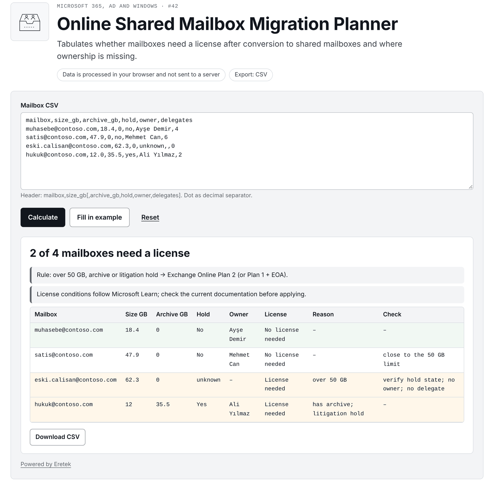

# Shared Mailbox Migration Planner

Work out license needs for mailboxes converted to shared mailboxes: the 50 GB limit, archives and litigation hold; flag missing owners and delegates.

## Try it live

- [Türkçe](https://sistem.eretek.com/araclar/shared-mailbox-gecis-plani)
- [English](https://sistem.eretek.com/en/tools/shared-mailbox-migration-planner)
- [Deutsch](https://sistem.eretek.com/de/werkzeuge/shared-mailbox-migrationsplaner)



## What it does

Tabulates whether mailboxes need a license after conversion to shared mailboxes and where ownership is missing.

Converting leavers' or department mailboxes to shared mailboxes saves licenses, but Microsoft documents conditions: mailboxes over 50 GB, with an archive or on litigation hold need a license (Exchange Online Plan 2 or Plan 1 + Exchange Online Archiving). If the hold state is unknown, no decision is possible; the tool marks that as 'verification needed'.

## Where it helps

Shared mailboxes without an owner cause audit findings; give every mailbox a responsible owner and at least one delegate.

After conversion, verify size below 50 GB and no hold/archive before removing the license.

## How to use it

1. Prepare a CSV: `mailbox,size_gb,archive_gb,hold,owner,delegates` (hold: yes/no/unknown). Use `Get-EXOMailboxStatistics` for sizes and `Get-Mailbox | select LitigationHoldEnabled` for hold.
2. Paste it and press Calculate; download the plan as CSV.

### Fields

| Field | Description |
|---|---|
| Mailbox CSV | Header: mailbox,size_gb[,archive_gb,hold,owner,delegates]. Dot as decimal separator. |

## Example input

Press **Fill in example** in the tool to load this input.

**Mailbox CSV**

```text
mailbox,size_gb,archive_gb,hold,owner,delegates
muhasebe@contoso.com,18.4,0,no,Ayşe Demir,4
satis@contoso.com,47.9,0,no,Mehmet Can,6
eski.calisan@contoso.com,62.3,0,unknown,,0
hukuk@contoso.com,12.0,35.5,yes,Ali Yılmaz,2
```

**Expected result:** muhasebe: no license; satis: 47.9 GB, near the limit; eski.calisan: 62.3 GB → license needed, hold unknown, no owner; hukuk: archive and hold → license needed.

## Method and assumptions

License needed: size_gb > 50 or archive_gb > 0 or hold = yes. If hold is unknown and no other condition applies, the result is 'verification needed'. 45–50 GB is also flagged as 'near the limit'.

The rules are based on Microsoft Learn 'About shared mailboxes' and 'Remove a license from a shared mailbox'; check the current documentation before applying, as it may change.

## Limits and common mistakes

- It does not connect to the tenant; it evaluates the CSV values.
- In-place holds and Microsoft Purview retention policies are not evaluated separately; reflect them in the hold column.

## Run it locally

The tool is plain HTML, CSS and JavaScript with no build step and no dependencies.

```bash
git clone https://github.com/eretek/shared-mailbox-migration-planner.git
cd shared-mailbox-migration-planner
node scripts/serve.js        # or: python3 -m http.server 8080
```

Open <http://127.0.0.1:8080/>. Add `?lang=tr` or `?lang=de` for Turkish or German; without it the page follows the browser language and falls back to English. You can also open `index.html` directly from disk.

Run the tests (Node.js 18 or later):

```bash
node test/run.js    # or: npm test
```

The tests run the tool's own fixtures and the worked examples in all three languages without a browser.

## How it works

All processing happens in your browser. The tool makes no network requests, uses no cookies or browser storage, and does not upload files you select.

No server-side component is needed. The version on the Eretek website renders the same page through a private WordPress plugin; that plugin only produces the page markup and is not part of this repository.

| Path | Purpose |
|---|---|
| `index.html` | Page shell |
| `src/app.js` | Builds the page in Turkish, English or German from `src/data.js` |
| `src/data.js` | Field definitions, examples and all texts in three languages |
| `src/core.js` | Shared runtime: validation, number formats, result rendering, CSV/ICS export |
| `src/tool.js` | The calculation or analysis for this tool |
| `docs/screenshot.png` | Screenshot used in this README |
| `src/tools.css`, `src/page.css` | Styles |
| `test/run.js`, `test/cases.json` | Headless tests |

## License and attribution

This tool is released under the [Eretek Website Attribution License](LICENSE). You may use, modify and redistribute it, including commercially. If you make it available on a website or web application, show a visible, clickable credit linking to https://eretek.com/ on every page where the tool is available, for example:

```html
<a href="https://eretek.com/">Powered by Eretek</a>
```

You may add `rel="nofollow"` to the link. Keep the copyright notice and license text in copies and redistributions.
